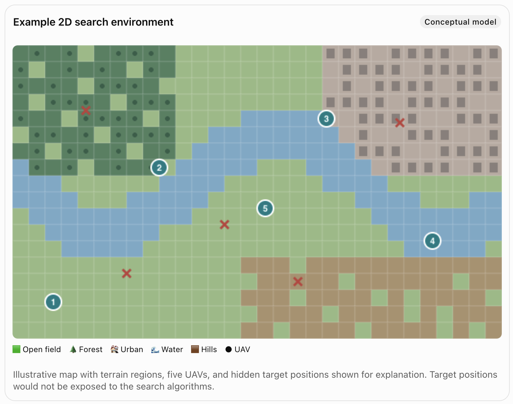
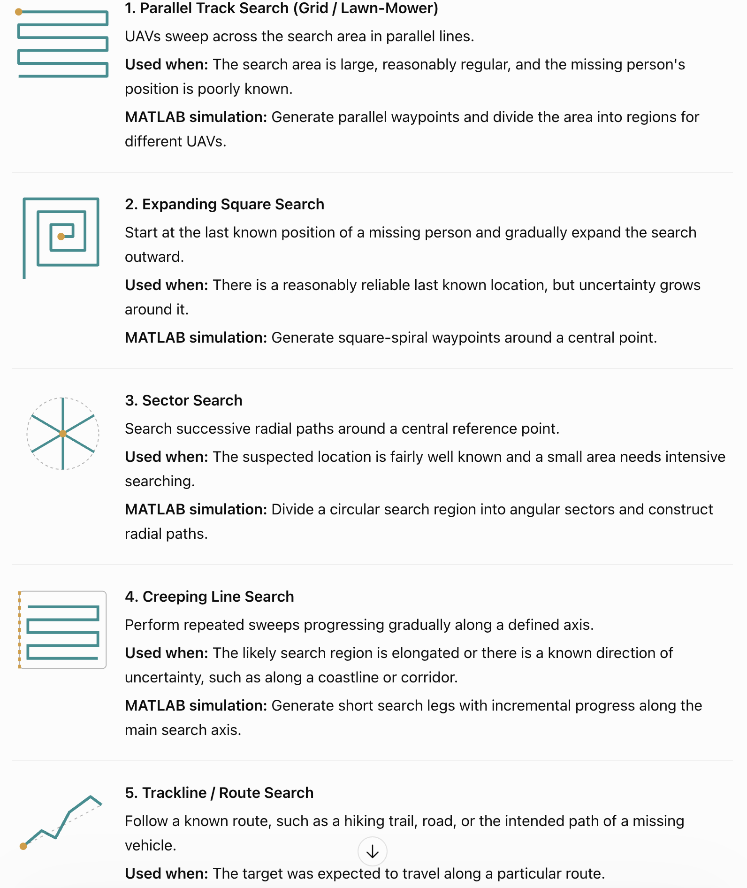

# Drone Search and Rescue Simulation using Monte Carlos and Discrete time simulation.

## 1. Simulation Configuration

- Number of UAVs (configurable: 1, 2, 3, 5, 8, 10)
- Number of missing people (configurable: 1,2,3,4,5,6,7,8,9,10) can also be unknown
- Map size (configurable: 1,2,3,4,5,6,7,8,9,10)
- Simulation duration
- Simulation time step
- Random seed

## 2. UAV Fleet

Each UAV has the following properties:

- Current position (X, Y)
- Battery level
- Flight speed
- Sensor detection probability
- Vision range
- Battery consumption rate
- Operating status (Searching, Returning, Inactive)
- Assigned destination

## 3. Environment

### 3.1 Terrain

- Terrain type (Open field, Forest, Water, Urban, Hills)
- Terrain visibility factor
- Detection probability modifier
- Flight restrictions
- Terrain generation probability (optional)

### 3.2 Missing People

- Unique identifier
- Coordinates (X, Y)
- Detection status (Found / Not Found)
- Detection time

## 4. Search Strategies

Each strategy controls the entire UAV fleet. The number of UAVs is configurable and identical across strategies within an experiment.

- Parallel Track Search – UAVs follow systematic parallel paths across the search area.
- Expanding Square Search – UAVs search outward from a known reference location.
- Sector Search – UAVs search radial paths around a central reference point.
- Probability-Based Search – UAVs prioritize areas with higher estimated probabilities of containing missing people.
- Adaptive Cooperative Search – UAVs coordinate and dynamically reassign search tasks based on mission progress.

## 5. Performance Evaluation

### 5.1 Search Effectiveness

- Detection rate
- Average detection time
- Time to reach a target detection percentage
- Area coverage percentage
- Search overlap and redundancy

### 5.2 UAV Resource Utilization

- Total battery consumption
- Total UAV flight time
- UAV utilization rate

### 5.3 Cost-Effectiveness

- Total operational cost
- Cost per detected person
- Operational cost versus detection time
- Marginal benefit of adding more UAVs

## 6. Simulation Experiments

- Experiment 1: Search Strategy Comparison – Compare the five strategies under identical simulation conditions.
- Experiment 2: UAV Fleet Size Comparison – Evaluate how increasing the number of UAVs affects detection time, coverage, and performance.
- Experiment 3: Cost-Effectiveness Analysis – Determine whether additional UAVs provide sufficient performance improvement to justify their cost.
- Experiment 4: Terrain Impact Analysis – Evaluate how different terrain types affect the performance of search strategies.
- Experiment 5: Sensor Reliability Analysis – Evaluate how changes in detection probability affect mission success.

## 7. Expected Outputs

- Animated 2D UAV search simulation in MATLAB
- UAV trajectories and search coverage maps
- Detection rate comparison graphs
- Search time versus UAV fleet size graphs
- Operational cost versus fleet size graphs
- Cost-effectiveness comparison across search strategies
- Statistical summaries from repeated Monte Carlo simulations
- Final analysis and conclusions identifying suitable strategies and fleet sizes under different conditions
