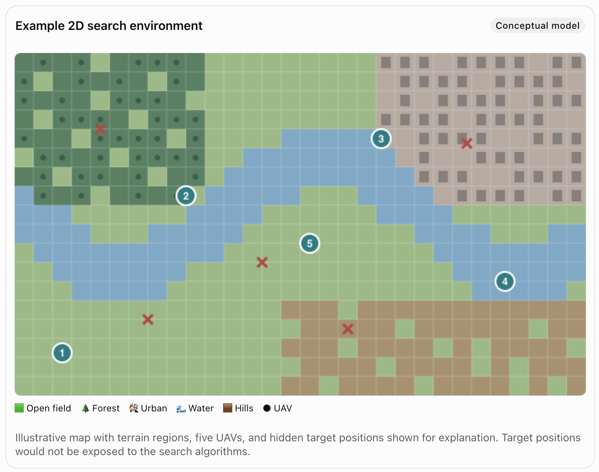

# Drone Search and Rescue Simulation

**System Simulation Technology (SE5207) — team project**

A discrete-time Monte Carlo simulation of a UAV fleet searching for one missing person on a
gridded terrain, implemented in MATLAB. The system evolves in fixed time steps, the target
location and every sensor outcome are stochastic, and each configuration is repeated many times so
that results can be reported with confidence intervals.



*Conceptual environment from the original draft. The prototype implements four terrain classes
(open, forest, urban, water) and one missing person; hills are left to future work.*

---

## 1. Objective

The paper answers three questions, in this order:

1. **Fleet-size saturation.** How does the probability of finding the target grow with the number
   of drones, and at what fleet size does adding another drone stop helping?
2. **Strategy comparison across terrain.** At each strategy's own saturation fleet size, does the
   ranking of the strategies survive when the terrain changes?
3. **Sensor sensitivity.** How much do the conclusions depend on the sweep width, which is the least
   certain input of the model?

Cost-effectiveness is **not** studied: the team has no reliable unit-cost data, so any cost model
would be invented rather than measured.

### 1.1 Assessment requirements

Two hard requirements come from the course, not from the model:

- **Paper length ≥ 5,000 words** (excluding references). The current draft is about 6,700.
- **A presentation in the final class**, roughly 10 minutes, plus questions.

Both deliverables are built from the same three figures and three experiments, so the presentation
adds no new simulation work.

---

## 2. Simulation configuration

| Parameter | Value | Meaning |
|---|---|---|
| Grid | 40 × 40 cells | search area |
| Cell size | 100 m | 4 km × 4 km = 16 km² |
| Time step | 20 s | one simulation tick |
| Mission length | 300 steps | 100 min of search per replication |
| UAV speed | 1 cell/step | 5 m/s ≈ 18 km/h |
| Launch point | cell (20, 20) | map centre |
| Fleet size | N = 1 … 20 | swept in Experiment 1 |
| Replications | 400 per configuration | Monte Carlo sample size |
| Seeds | map 7, target 1000 | fixed, so every run is reproducible |

All numbers live in `config.m`; no other file contains a tunable constant.

---

## 3. UAV model

Each drone is a point that moves one *king move* (8-neighbour) per step toward its current
waypoint. It carries one downward-looking sensor whose detection performance is summarised by a
**sweep width** (Section 4.3).

Modelled state per drone: position and current waypoint. Navigation is assumed perfect.

**Battery is not modelled in v1.** The mission is treated as continuously supported (battery
swaps at base), which keeps the fleet-size comparison free of charging artefacts. Battery,
return-to-base and recharge states are listed as future work.

---

## 4. Environment

### 4.1 Terrain

| Class | Code | Sweep-width multiplier |
|---|---|---|
| Open field | 1 | 1.00 |
| Forest | 2 | 0.55 |
| Urban | 3 | 0.45 |
| Water | 4 | 0.20 |

Four maps are used: `open`, `forest`, `urban` and `mixed`. Modelling terrain as a multiplier on the
sweep width follows IAMSAR practice, where sweep width is tabulated per terrain/visibility and then
corrected by factors (Vol. II, Tables N-4 … N-10). Terrain that changes speed but not detection
would be physically wrong and is not used.

### 4.2 Search prior

A probability map `prior(row, col)` states where the missing person probably is. It is built from

- a terrain weight (a person is more likely in forest/urban cover and almost never in water), and
- two Gaussian "last seen" hot spots.

The prior sums to 1 and is the **only** extra information the probability-based strategy receives.
The other two strategies ignore it, which is the point of the comparison.

### 4.3 Detection model

With track spacing equal to one cell and sweep width `W` measured in cells, one pass over a cell
detects the target with

```
p_pass = 1 - exp(-W_eff / S),   S = 1 cell
W_eff  = sweep_width × terrain_multiplier × sensitivity_scale
```

Every visit is an independent trial, so after `k` passes

```
P(k) = 1 - (1 - p_pass)^k
```

This is the cell form of Koopman's random-search curve. It is a **conservative lower bound** for a
well-spread systematic sweep (the better definite-range result is `erf(pi*W/2S)`), and the paper
labels it as such. Using one cited formula replaces the arbitrary per-terrain constants of the
first draft.

### 4.4 Missing person

One static target, drawn from the prior at the start of each replication. The **same** target index
is reused for every strategy and fleet size (common random numbers), so differences between
strategies are not caused by different targets.

---

## 5. Search strategies

| ID | Strategy | Behaviour | Role |
|---|---|---|---|
| S1 | **Parallel track** | the map is split into N horizontal bands; each drone sweeps its band in a lawn-mower pattern and repeats it | systematic baseline, IAMSAR-valid for multiple searchers |
| S2 | **Probability-based** | the map is cut into 8 × 8 blocks ranked by prior mass; drones take the most likely unsearched block, sweep it, then take the next | the "smart" strategy |
| S3 | **Random walk** | each drone moves to a random 8-neighbour cell | null baseline: what intelligence buys |

**Why only three.** IAMSAR defines expanding square and sector search as **single-aircraft**
patterns, so running them for a whole fleet is not doctrinally valid without redefining them (a
research contribution, not a two-week exercise). Adaptive cooperative search needs inter-drone
communication and task reallocation and is the least standardised part of the original draft. Both
are cut, not forgotten.

---

## 6. Output metrics

| Metric | Definition |
|---|---|
| `P_found` | fraction of replications in which the target is detected before `tMax` |
| `T_found` | mission step of detection (censored at `tMax`) |
| `coverage` | fraction of cells visited at least once during the full fixed-duration mission (not truncated at detection time) |
| 95% CI | Wilson score interval on `P_found` |

**Saturation fleet size N\*** — no closed-form optimum exists, so it is defined operationally.
With `N = 1 … 20` and `P(N)` the measured detection probability:

1. **Smooth** the curve with a 3-point moving average, endpoints unchanged:
   `P̃(N) = (P(N−1) + P(N) + P(N+1)) / 3` for `2 ≤ N ≤ 19`.
2. **Plateau:** `P_plateau = (P̃(18) + P̃(19) + P̃(20)) / 3`.
3. **N\* = the smallest N with `P̃(N) ≥ 0.95 × P_plateau`.**

Smoothing and averaging the last three points both exist to stop one noisy fleet size from moving
N\* by several drones. N\* is reported with its confidence interval and treated as accurate to about
±2 drones. Experiments 2 and 3 then run every strategy at its own N\*.

A stricter "every extra drone adds less than 2 percentage points" rule is not usable: with 400
replications the confidence interval near P = 0.9 is about ±3 pp, so a 2 pp test sits inside the
noise and a slowly rising curve never satisfies it.

---

## 7. Experiments

### Experiment 1 — Fleet-size saturation (open map)

- N = 1 … 20, three strategies, identical mission time and identical targets.
- Output: `P_found(N)` with 95% CI, the saturation point N\* per strategy, and the marginal-gain
  curve.
- Sanity check: `P_found(N)` must be non-decreasing within its confidence interval and can never
  exceed 1. The closed-form independence bound `1 - (1 - P_1)^N` is checked on the **random-walk**
  baseline only; it does not apply to parallel track, where each drone's band shrinks as the fleet
  grows.

### Experiment 2 — Strategy comparison across terrain

- Terrains: open, forest, urban, mixed.
- Each strategy runs at its own N\* from Experiment 1.
- Output: grouped bar chart with confidence intervals.
- Question: does the ranking from Experiment 1 hold when terrain changes?

### Experiment 3 — Sweep-width sensitivity

- Sweep width scaled by ×0.5, ×1 and ×2 on the open map, fleet sizes fixed at N\*.
- Output: `P_found` versus sensor scale.
- Rationale: it costs one multiplier and answers the "sensor reliability" question of the draft.

---

## 8. Verification

`validate_sim.m` runs six checks before any result is used:

1. the prior sums to 1 and `detP` matches `1 - exp(-W)` for every terrain class;
2. a Monte Carlo of the per-pass detection reproduces the analytic `p`;
3. the random-walk baseline stays below the independence bound `1 - (1 - P_1)^N`;
4. coverage increases with fleet size for the systematic strategy;
5. a fixed seed reproduces the same mission exactly;
6. the saturation rule finds the knee of a synthetic curve.

The summary must be 6 / 6 PASS.

---

## 9. Assumptions and limitations

- The map is a grid; real search areas are continuous. Cell size is a modelling choice.
- The target is static and does not react to the drones.
- Detection trials are independent, both within and between passes.
- Terrain multipliers are illustrative values in the range used by IAMSAR, not measurements for a
  specific sensor.
- The nominal sweep width is **one grid cell**, i.e. a modelling unit chosen so that track spacing
  equals sweep width (the documented full-coverage convention), not a calibrated sensor figure.
  IAMSAR tabulates sweep width for manned aircraft and vessels (about 0.2 NM for a person in water
  seen from a vessel); no equivalent table exists for small multirotor sensors (Sulaiman & Pierce,
  2023). Anchoring `W` to a real sensor would require both a different grid resolution and a
  drone-specific table, and is left as future work.
- No wind, no terrain-induced speed changes, no communication limits, no collisions.
- One missing person only.
- Validation against real SAR outcome data is outside the scope of the course project; the paper
  verifies the implementation, not the real-world accuracy.

---

## 10. Out of scope / future work

- Battery, return-to-base and recharge as explicit states.
- Multiple missing people (the original draft allowed 1…10).
- Hills terrain class.
- Adaptive cooperative task reassignment.
- Cost-effectiveness analysis.
- Animated playback of a mission.

---

## 11. MATLAB implementation

| File | Purpose |
|---|---|
| `config.m` | all parameters |
| `make_scenario.m` | terrain, prior and detection map |
| `boustrophedon.m` | lawn-mower path over a rectangle |
| `rank_blocks.m` | blocks sorted by prior mass |
| `simulate_once.m` | one mission of the fleet |
| `optimal_n.m` | saturation rule (N\*) |
| `wilson_ci.m` | 95% confidence interval |
| `run_experiment1.m` | fleet-size saturation |
| `run_experiment2.m` | strategy × terrain |
| `run_experiment3.m` | sweep-width sensitivity |
| `validate_sim.m` | the six self-checks |
| `check_sampling.m` | inverse-transform validation: 20 000 draws vs the analytical prior (Figure 5) |
| `run_convergence.m` | running estimate and 1/√n half-width (Figure 4) |
| `style_figure.m` | shared figure styling for all exports |
| `plot_scenario.m` | scenario figure |
| `run_all.m` | verification, the three experiments and the two methodological checks |

Run order:

```matlab
validate_sim          % must print 6 / 6 PASS
run_all               % verification, Experiments 1-3, convergence and sampling checks
plot_scenario('mixed', 5)
```

`run_all` produces every table and figure in the paper: `results/exp1..exp4` (CSV and MAT) and
`figures/fig1..fig5` (PNG).

---

## 12. References

- IAMSAR Manual, Vol. II, Ch. 5, *Search patterns and sweep width* (2019 edition).
- B. O. Koopman, "The theory of search II", *Operations Research* 4(5), 1956.
- L. D. Stone, *Theory of Optimal Search*, Academic Press, 1975.
- J. R. Frost & L. D. Stone, *Review of Search Theory*, 2001.
- R. Perkins & D. Lovelock, *Lateral range curves, search probabilities and grid searching*, 2008.
- M. N. Haddad, A. C. Santos et al., "Intelligent drone swarms to search for victims in post-disaster
  areas", *Sensors* 23(23):9540, 2023.
- R. Shao, R. Tao, Y. Liu, Y. Yang, D. Li & J. Chen, "UAV cooperative search in dynamic environment
  based on hybrid-layered APF", *EURASIP J. Adv. Signal Process.*, 2021.
- A. Sulaiman & K. Pierce, "Modelling maritime SAR effective sweep widths for helicopters in VDM",
  arXiv:2304.00983, 2023.
- A. M. Law, *Simulation Modeling and Analysis*, 5th ed., McGraw-Hill, 2015.
- J. Banks et al., *Discrete-Event System Simulation*, 5th ed., Pearson, 2010.
- B. P. Zeigler, H. Praehofer & T. G. Kim, *Theory of Modeling and Simulation*, 2nd ed., 2000.
- R. G. Sargent, "Verification and validation of simulation models", *Journal of Simulation* 7(1),
  2013.

---

## 13. Deliverables

| File | Purpose |
|---|---|
| `UAV_SAR_Paper_Outline.docx` | writing plan: section prompts, word budgets, member split, table shells |
| `matlab/` | the simulation, exactly as used to produce the results |

The paper itself is written section by section from the outline. Each member writes their own
section in their own words; the numbers are fixed and must not be re-derived.
