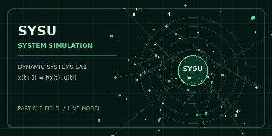

<div align="center">

# SYSU System Simulation



**Modeling · Simulation · Dynamic Systems**

</div>

---

## SE5207 team project: cooperative UAV search and rescue

A discrete-time Monte Carlo simulation of a small UAV fleet searching for one missing person on a
gridded map. Three search strategies are compared across four terrain types, at fleet sizes from
one to twenty aircraft, with 400 replications per configuration and 95% confidence intervals.

The study asks three questions: how detection probability saturates with fleet size, whether the
strategy ranking survives a change of terrain, and how sensitive the conclusions are to sensor
quality.

## Repository layout

| Path | Contents |
|---|---|
| [`docs/requirement.md`](docs/requirement.md) | the full specification: model, detection law, strategies, N* rule, experiments, verification, limitations |
| [`matlab/`](matlab) | the simulation as run: model, three experiments, two methodological checks, verification suite |
| [`docs/UAV_SAR_Paper_Outline.docx`](docs/UAV_SAR_Paper_Outline.docx) | writing plan: section prompts, word budgets, member split |
| [`docs/references/`](docs/references) | the 13 sources, what each supports and where it is cited |
| [`docs/research-notes.md`](docs/research-notes.md) | why the design is what it is: the evidence behind each decision |
| [`archive/`](archive) | superseded first-draft stub, kept for reference only |

## Collaboration documents

| Document | Link |
|---|---|
| Team roles and plan | [Google Doc](https://docs.google.com/document/d/1cKCjBaCZrian9eQxZ94Oi0Pwl0C1RkQFMKTqkF32dhI/edit?usp=sharing) |
| Paper outline and writing plan | [Google Doc](https://docs.google.com/document/d/1JtkWTIxIGMWLt9Xu458Zk6RXfgl2n35RyDgKpGXHlS8/edit?usp=sharing) |

Both are edited online. The repository holds the fixed inputs — specification, code, results — and
the documents hold the writing.

## Run it

For an interactive interface to select a map and strategy, animate a mission,
and run statistical analysis, open MATLAB and run:

```matlab
cd matlab
search_app
```

To reproduce the project experiments:

```matlab
cd matlab
validate_sim     % ten self-checks, must print 10 / 10
run_all          % three experiments + convergence and sampling checks
```

Every table and figure in the paper is regenerated by `run_all`; the seeds are fixed, so the
numbers are identical on any machine running the same MATLAB version.

## Headline results (400 replications)

| | Parallel track | Probability-based | Random walk |
|---|---|---|---|
| N = 1 | 0.040 | 0.365 | 0.048 |
| N = 20 | 0.943 | 0.963 | 0.540 |
| Saturation N* | 14 | 15 | 18 |

- Prior-guided search wins only for small fleets; at saturation the two planned strategies are
  statistically indistinguishable on every terrain.
- Terrain lowers success by 7 to 13 percentage points without reordering the planned strategies.
- Halving the sweep width costs about 19 percentage points - more than any strategy choice.

## Notes

- The simulation is MATLAB-only. An earlier Python prototype is kept locally and is not part of the
  deliverable.
- The original `app/` stub has been moved to [`archive/`](archive); it is not used by the simulation.
